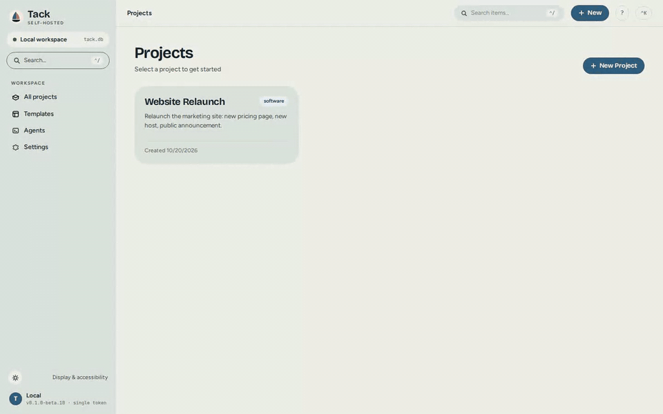
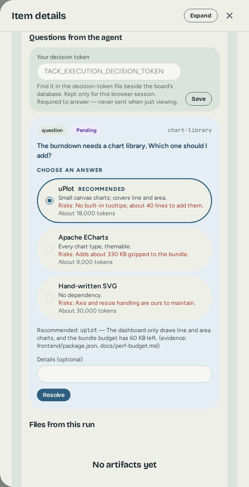
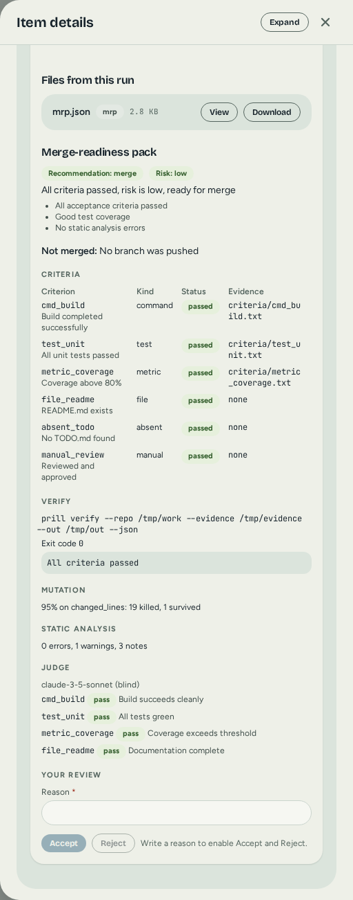
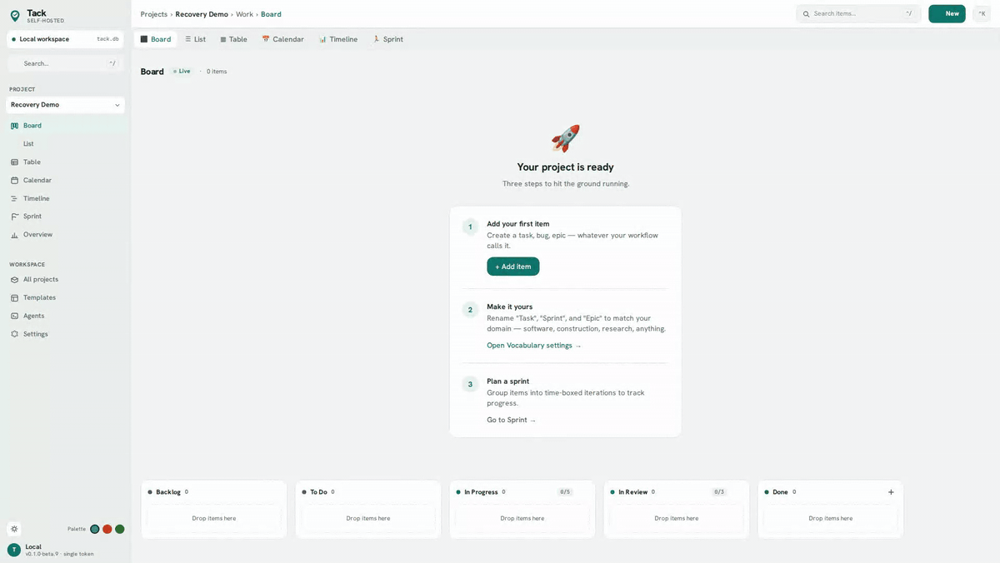
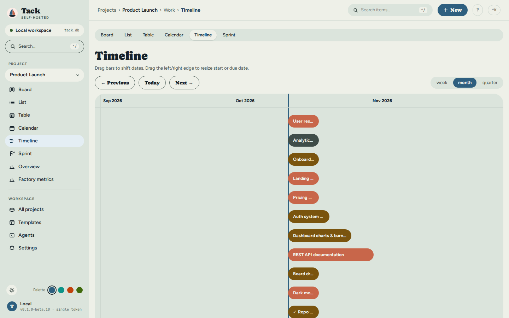
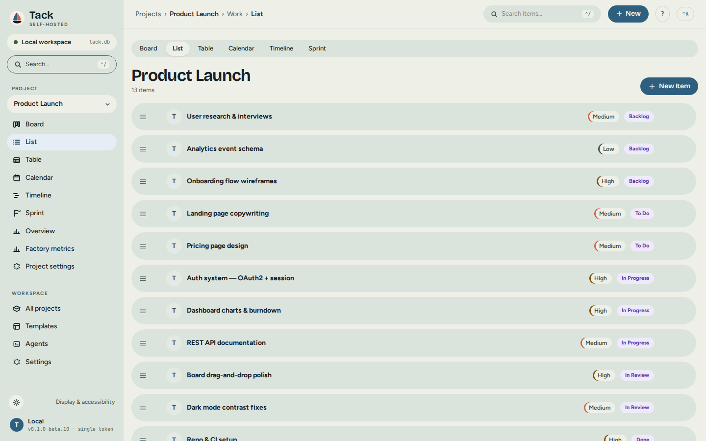
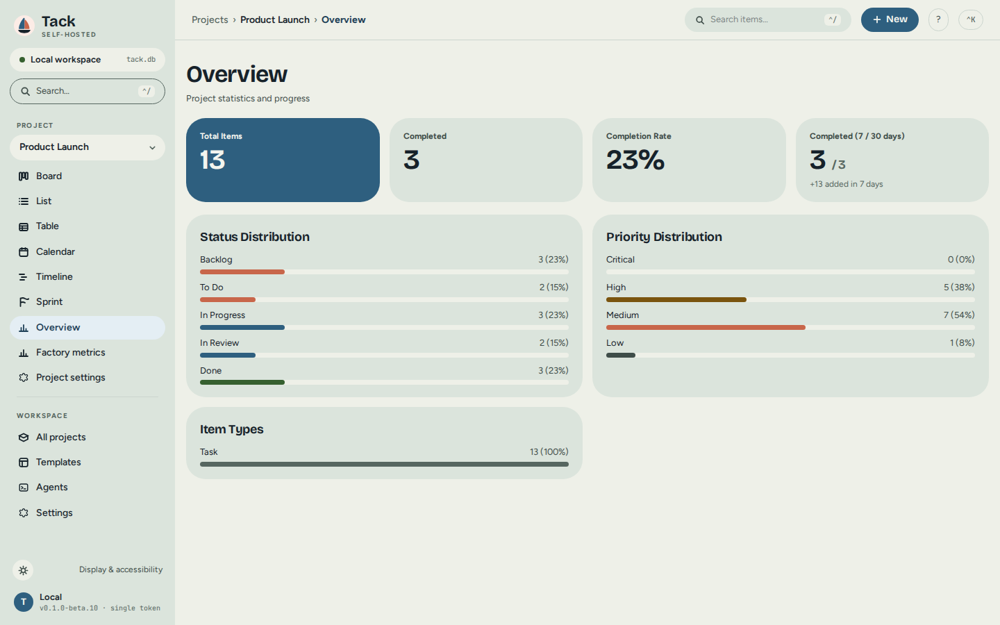
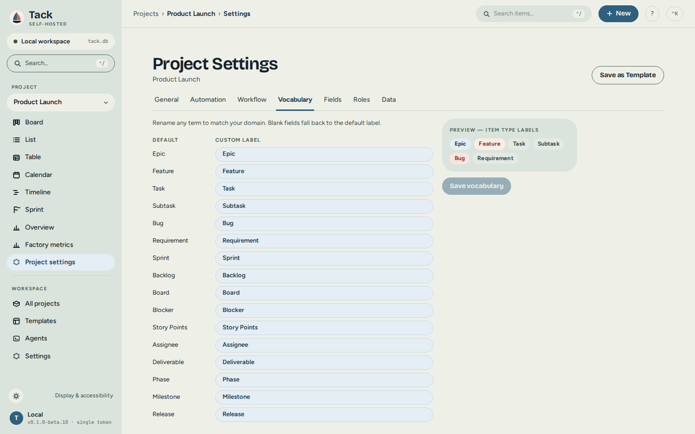
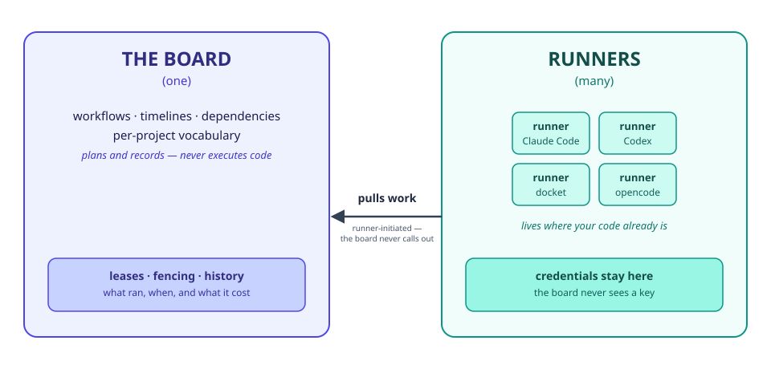

# Tack

[](https://github.com/yielab/tack/actions/workflows/ci.yml)
[](LICENSE)
[](https://www.rust-lang.org/)
[](CHANGELOG.md)

**Plan the work, let your coding agents do it, and check it before you merge.**

Tack is a project board that runs Claude Code, Codex, opencode or docket on your own
machine, on the subscription you already pay for, and keeps every run, question and change
on the task. A desktop app, or the same binary as a server. One SQLite file, no account.

<p align="center">
  
</p>

```bash
TAG=v0.1.0-beta.10
curl --proto '=https' --tlsv1.2 -fsSL "https://github.com/yielab/tack/releases/download/$TAG/install.sh" | TACK_VERSION="$TAG" sh
tack serve --with-runner        # then open http://localhost:3210
```

Or download the desktop app from the [releases page](https://github.com/yielab/tack/releases/latest).
Every other way to install is under [Get started](#get-started).

> [!NOTE]
> Tack is in public beta. It works end to end, but it hasn't been run in production yet:
> expect rough edges and breaking changes between releases, and run `tack backup` before
> you upgrade. [Status](#status) says what has been proven so far.

## Why Tack

Coding agents already write code well. What they don't give you is a plan to work from, a
record of what they did, and a reason to trust it. Tack gives you all three, and it is a
project board worth using on its own.

- **Your agent, your subscription, your machine.** Press ▶ on a task and pick an agent. It
  runs with its own login (Claude Pro/Max, a ChatGPT plan) or a key you gave the runner. The
  board never holds a model credential.
- **Review the evidence, not the agent's word.** Every run leaves a patch and a file list. A
  verifier can re-check the change and write a merge-readiness pack you accept or reject.
- **It asks before it acts.** Set approvals to *Ask me* and the agent waits for you on the
  task, with its options, their risks and its recommendation.
- **A full project manager underneath.** Six views, Scrum, Kanban or phases, dependencies,
  and your own words for everything. All of it works with no agent set up.
- **Numbers are measured, never guessed.** Cost and tokens show what the agent reported, or
  say *Not measured*. Never an estimate, never a silent `0`.
- **A run survives a crash.** Kill a run halfway and Tack neither loses it nor starts it
  again behind your back. It stops and asks you.
- **Nothing else to run.** An 18.5 MiB binary using about 18 MiB of memory at rest
  ([Benchmarks](docs/BENCHMARKS.md)). No database server, no Docker, no cloud.

## Run a task with an agent

1. **Say what "done" means.** A task is a description plus acceptance criteria, and the
   project knows where its code is.
2. **Press ▶ Run with agent.** The dialog shows who runs it, what the agent will read and what
   happens after. The agent works on a new branch of your repository, or in your folder.
3. **Watch it on the task.** Progress arrives live. A question from the agent waits in the
   task's decision inbox.
4. **Review what it did.** A run that changed files flags the task **Needs your review** and
   hands over the diff, the branch and the result. You accept or reject it.

<p align="center">
  
</p>

**Four agents, one flow.** Claude Code, Codex, docket and opencode, each driven through its
own adapter. The task looks the same whichever one runs.
[Choosing an agent](docs/book/src/user-guide/agent-runners.md#choosing-a-harness) says what
each needs and what each can't do.

**You choose how it's paid for.** Use the agent's own subscription and Tack never sees the
credential. Or give the runner an API key for an endpoint: Anthropic's API, a gateway such as
Vercel AI Gateway, or an OpenAI-compatible server on your own machine (llama.cpp, LM Studio,
vLLM, Ollama) for docket and opencode. The model list comes live from that endpoint, not from
a hand-kept file.

**Start from a plan you already have.** Create a project and all its tasks from one outline
or CSV: yours, a spreadsheet's, or one an AI assistant wrote. From the UI, `tack import` or
MCP — see [Import and Export](docs/book/src/user-guide/import-export.md#how-do-i-create-a-project-and-its-items-from-a-file).

**The Agents page gets you started.** It shows which agents this computer has and whether
they're logged in, and runs a test with nothing typed.

## Review before you merge

An agent's report about its own work is a claim, not a proof. Tack keeps what the run
actually did and lets something other than the agent check it.

- **Evidence on every run.** The patch, the commits and the list of files changed, kept
  after the workspace is cleaned up.
- **Verifiable by something other than the agent.** A runner hands that evidence to an
  independent verifier of your choice: a program of your own, or an external checker such as
  prill. The verifier writes a merge-readiness pack with a recommendation, the risk, each
  acceptance criterion with its evidence, and anything it did not check, marked *Not run*. It
  is off until you turn it on in the runner's configuration.
- **Branch and pull request.** The runner can push the work as a branch. For a task linked
  to a GitHub issue, Tack opens the pull request and shows its state on the run.
- **Factory metrics.** Each project has a page showing how often agents needed you, how long
  you took, and how much of what they opened was merged.

<p align="center">
  
  
</p>

### A run survives a crash

A runner killed mid-run. The attempt turns `needs_operator` instead of running twice; you
decide, and the retry succeeds. Recorded from a real release binary.

<p align="center">
  
</p>

[`scripts/record-recovery-demo.sh`](scripts/record-recovery-demo.sh) re-records it, and
[`scripts/smoke.sh`](scripts/smoke.sh) checks the same sequence on every run.

## A full project manager, with or without agents

Everything here works the moment Tack starts, with no agent set up.

<p align="center">
  
  
</p>

- **Six views:** board, list, table, calendar, timeline and overview.
- **Your workflow:** Scrum, Kanban or phases, with WIP limits.
- **Your words.** Rename *Task*, *Sprint* or *Backlog* per project. The UI, CLI and
  API all use your terms.
- **Dependencies that matter.** Cycles are rejected, and a task waiting on unfinished
  work isn't handed to an agent.
- **The rest you'd expect:** sub-items, custom fields, comments, attachments, full-text
  search, templates, bulk edits, live updates across tabs.
- **Your data stays portable.** Export to JSON, YAML or CSV. Import from GitHub Issues or
  Linear. Back up locally or to S3-compatible storage.

<details>
<summary>More screenshots: overview and vocabulary</summary>
<br>





</details>

## Reach it from anywhere

- **CLI** with JSON output. `tack start <id>` moves a task to in progress and checks
  out its branch.
- **REST API** with a checked-in [OpenAPI spec](docs/openapi.json).
- **MCP server** (`tack mcp`): Claude Code, Codex and other MCP clients can read and
  update the board, within the same workflow rules, and create a whole project from an
  outline.
- **GitHub sync:** a linked issue's state and comments flow both ways. Signed outbound
  webhooks for everything else.
- **Desktop app** with a tray icon, and `tack service install` to keep Tack running in
  the background. Closing the window doesn't stop the work.

## Get started

**Desktop app — the default.** Download it from the
[releases page](https://github.com/yielab/tack/releases/latest): `.AppImage` or `.deb` on
Linux, `.dmg` on macOS (Apple Silicon and Intel), `.msi` on Windows. Open it and the
board opens in its own window; behind it runs the same `tack serve --with-runner`.

**The server**, `tack serve`, is the same binary and the same data, for a machine with no
desktop, a host other people reach, or automation:

```bash
TAG=v0.1.0-beta.10
curl --proto '=https' --tlsv1.2 -fsSL "https://github.com/yielab/tack/releases/download/$TAG/install.sh" | TACK_VERSION="$TAG" sh
tack serve --with-runner
```

Or `brew install yielab/tap/tack`. On Windows,
`$tag = 'v0.1.0-beta.10'; $env:TACK_VERSION = $tag; irm "https://github.com/yielab/tack/releases/download/$tag/install.ps1" | iex`
in PowerShell.
Open **<http://localhost:3210>**. The installer checks every download against the
release's `SHA256SUMS`. Other ways to install — Homebrew, Scoop, Docker, a release
archive, or building from source — are in the
[Quick Start](docs/book/src/user-guide/quick-start.md). The
[Step-by-Step Tutorial](docs/book/src/user-guide/tutorial.md) walks the whole path
from here to a finished agent run, with a real screenshot at every step.

**Which one do I have?**

- **Where is my data?** Either way it is `tack.db` plus the `storage/` folder; back up
  both. The desktop app keeps them in `~/.local/share/tack` (Linux),
  `~/Library/Application Support/tack` (macOS) or `%APPDATA%\tack` (Windows). The server
  uses `TACK_DATABASE_URL` and `TACK_STORAGE_DIR`, which default to the folder it starts
  in — see [`docs/CONFIG.md`](docs/CONFIG.md).
- **Do agents run on this machine?** With the desktop app, or `tack serve --with-runner`,
  yes: a runner starts inside the same process. Without the flag the board works fully
  and you can turn agents on later from the Agents page, no restart needed.
- **Do other people or machines use it?** Then run `tack serve` on the shared host and
  attach a separate `tack-runner` where agents should run —
  [Enrolling a runner](docs/book/src/user-guide/agent-runners.md#enrolling-a-runner).
  `--with-runner` only runs on `localhost`, because it starts agent processes.

> Binaries and the desktop app aren't code-signed yet. On macOS, right-click → **Open**
> the first time. On Windows, choose **More info → Run anyway**.

## How it works

<p align="center">
  <picture>
    <source media="(prefers-color-scheme: dark)" srcset="docs/diagrams/two-components-dark.svg">
    
  </picture>
</p>

- **The board** plans, schedules and keeps the record. It never runs code and never
  holds a model key.
- **Runners** live where the code and keys are — your laptop, a CI box, a GPU machine.
  They pull work; the board never calls out to them.
- **One board, many runners.** A dead runner can't corrupt the board: its lease
  expires and its writes stop. A restarted board can't lose a run: the runner's journal
  knows what it started.

Rust (Axum, SQLite) and SolidJS, as a modular monolith with the runner as its own
binary. The [architecture overview](docs/book/src/developer/index.md) has the detail.

## Built alongside

Two tools made with Tack that also work on their own:

- **[docket](https://github.com/yielab/docket)** gives a repository a team of coding agents
  and governs what they may do: roles, policies, approvals and an audit trail, in YAML next to
  your code. Tack runs it as one of its four agents.
- **prill** is an independent verifier of agents' changes. It re-runs the change on clean
  code in a sandbox with no network and writes a merge-readiness pack. It is one of the
  verifiers a Tack runner can use. It isn't published yet.

## Status

Public beta, still in development. The project manager and the agent runs are both
complete, and the desktop app ships for Linux, macOS and Windows. Claude Code and Codex have
recorded live end-to-end runs, and the whole workflow has run through the UI with docket as
the agent and an independent verifier checking each run, against a local model.
`tack runner doctor` shows what your own machine can run.

What it still needs is wider testing: no team has run it in production yet, so the
limitations below are the ones known so far, not all there are.

### Known limitations

- No user accounts: one shared API token, no per-user permissions
- One SQLite writer. S3 backup copies snapshots; it isn't live sync
- No offline mode and no native mobile app
- Only docket shows a run's steps on its timeline while it works; the other agents show
  them in the run's log
- Imported cost values may be estimates; Tack's own measurements always say where
  they came from
- Binaries aren't code-signed yet

The [roadmap](docs/book/src/roadmap.md) has what's next.

## Documentation

The full guide is at [yielab.github.io/tack](https://yielab.github.io/tack/)
(source in [`docs/book/`](docs/book/)).

| | |
| --- | --- |
| [Quick Start](docs/book/src/user-guide/quick-start.md) | Install and first run |
| [Agent Runners](docs/book/src/user-guide/agent-runners.md) | Agents, credentials, models, verification, recovery |
| [Import and Export](docs/book/src/user-guide/import-export.md) | A project from an outline or CSV, GitHub and Linear import, exports |
| [CLI](docs/book/src/user-guide/cli.md) · [API](docs/book/src/developer/api-reference.md) · [MCP](docs/MCP.md) | Reaching the board from outside the browser |
| [Configuration](docs/book/src/user-guide/configuration.md) | Environment variables and `tack.toml` |
| [Architecture](docs/book/src/developer/index.md) | Crates, boundaries and decisions |
| [Benchmarks](docs/BENCHMARKS.md) · [Testing](docs/TESTING.md) | How the numbers and the tests are produced |

## Contributing

See [CONTRIBUTING.md](CONTRIBUTING.md). Building from source needs
[Rust 1.94+](https://rustup.rs/) and [Node.js 22+](https://nodejs.org/).

```bash
git clone https://github.com/yielab/tack.git && cd tack
git config core.hooksPath .githooks   # fmt + clippy before every push, like CI
make dev                              # API + Vite hot reload
make test && make e2e                 # unit/integration and browser tests
```

## License

MIT — see [LICENSE](LICENSE).
