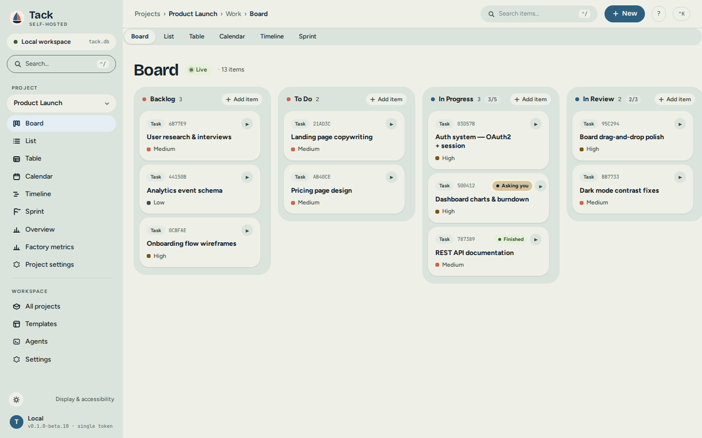
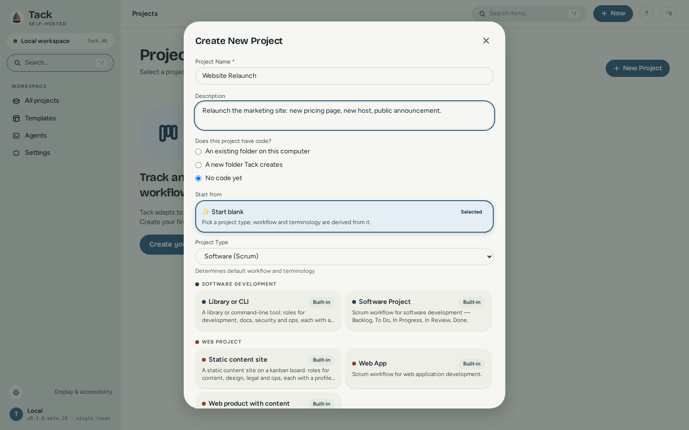
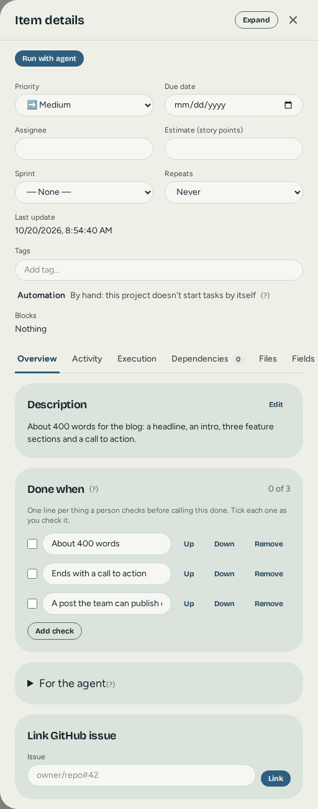
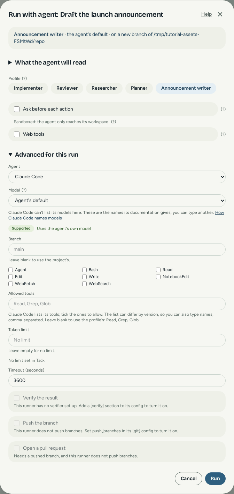

# Tack

**An open-source project manager that can assign tasks to AI agents.**

<p align="center">
  
</p>

<p align="center">
  <a href="https://github.com/yielab/tack/actions/workflows/ci.yml"></a>
  <a href="LICENSE"></a>
  <a href="CHANGELOG.md"></a>
</p>

Tack is a project manager for planning and tracking work. A project is made of tasks with
acceptance criteria, followed on a board, a list or a timeline, by sprint or by phase. It
can be used without any agent.

A task can also be assigned to an AI agent running on your computer: Claude Code, Codex,
opencode or docket. The agent receives the task and its acceptance criteria, and the work
can be code, writing or research. Its progress, its questions and the tokens it used are
recorded on the task, together with any files it changed, which you review and accept or
reject. In a project with code, the agent can work on a new branch of your repository and
leave your folder as it is.

Tack runs locally, as a desktop app or as a server, and keeps its data in a single SQLite
file. It requires no account.

[Website](https://yielab.com/tack) · [Documentation](https://yielab.github.io/tack/) · [Tutorial](https://yielab.github.io/tack/user-guide/tutorial.html) · [Releases](https://github.com/yielab/tack/releases/latest) · [Changelog](CHANGELOG.md)

> [!NOTE]
> Tack is in public beta. See [Status](#status) before you rely on it.

## Requirements

- **To use Tack:** Linux, macOS or Windows.
- **To assign tasks to an agent:** one of Claude Code, Codex, opencode or docket installed
  on the same computer (the documentation calls these *harnesses*), and a model for it, in
  one of two ways:
  - **The agent's own subscription.** Claude Code or Codex, signed in with your plan,
    which includes its models.
  - **An API key set in Tack's runner.** Claude Code and Codex can use one, and opencode and
    docket work only this way: a model gateway, or an OpenAI-compatible server, including
    one running local models.

  [Choosing a harness](https://yielab.github.io/tack/user-guide/agent-runners.html#choosing-a-harness) says
  what each one supports.
- **Optional:** git, so the agent works on a branch instead of directly in your folder.

## Install

### Desktop app

Download it from the [releases page](https://github.com/yielab/tack/releases/latest). It runs the board and the agent runner
together.

Release builds aren't code-signed yet, so macOS and Windows show a warning the first time
you open the app. Each release publishes `SHA256SUMS` and build attestations to check a
download against.

### Command line

The same program, served in your browser. Use it on a server, or if you prefer the terminal.

**macOS and Linux**

```bash
brew install yielab/tap/tack
```

Or with the install script, which checks the download against the release's checksums:

```bash
TAG=v0.1.0-beta.10
curl --proto '=https' --tlsv1.2 -fsSL "https://github.com/yielab/tack/releases/download/$TAG/install.sh" | TACK_VERSION="$TAG" sh
```

**Windows (PowerShell)**

```powershell
$tag = 'v0.1.0-beta.10'; $env:TACK_VERSION = $tag; irm "https://github.com/yielab/tack/releases/download/$tag/install.ps1" | iex
```

Then start it and open <http://localhost:3210>:

```bash
tack serve --with-runner    # --with-runner lets agents run on this computer
```

Scoop, Docker and building from source are in the [Quick Start](https://yielab.github.io/tack/user-guide/quick-start.html).

## Quick start

**1. Create a project** and choose the folder where its code is.



**2. Add a task** and write its acceptance criteria: what must be true when it's done.



**3. Run it with an agent** and review the result on the task.



**Agents** in the sidebar shows which agents Tack found on this computer and runs a
test. The [tutorial](https://yielab.github.io/tack/user-guide/tutorial.html) goes through every screen.

## Features

- **Project management.** Board, list, table, calendar and timeline views; Scrum, Kanban
  or phases; dependencies; and your own names for *Task* or *Sprint*. All of it works
  without an agent.
- **Agent runs.** Progress shows on the task while the agent works. With *Ask before each
  action*, it waits for your answer on the task. A run that changed files waits for your
  review.
- **Verification and delivery.** A verifier of your choice, a program of your own or a tool
  such as prill, can check the change against the acceptance criteria. The runner can push
  the work as a branch and, for a task linked to a GitHub issue, Tack opens the pull request.
- **Recovery.** A run interrupted by a crash isn't lost or started again. It waits for
  your decision.
- **Integrations.** A CLI, a REST API, an MCP server and two-way sync with GitHub issues.

Tack has two parts: the **board**, which stores projects, tasks and the record of every
run, and the **runner**, which takes tasks from the board and starts the agent where the
code is. The desktop app runs both. A server can serve a team, with runners on other
machines. See the [architecture](https://yielab.github.io/tack/developer/index.html).

## Security

Tack starts the agent on your computer, with your user's permissions. What it may
do is set first by the agent's own permission settings, then by what you give
Tack: the folder a project points at and the credentials the runner holds. The API
requires a token.
[What the agent can reach](docs/book/src/user-guide/what-the-agent-can-reach.md) explains
each of these, and [SECURITY.md](SECURITY.md) says how to report a vulnerability.

## Status

Tack is in public beta: it still changes between releases and hasn't been used in
production. Back up your data with `tack backup` before you upgrade. The
[changelog](CHANGELOG.md) lists what each release changed, and the
[roadmap](https://yielab.github.io/tack/roadmap.html) what comes next.

## Documentation

| Goal | Start here |
| --- | --- |
| Install and run a first task | [Quick Start](https://yielab.github.io/tack/user-guide/quick-start.html) · [Tutorial](https://yielab.github.io/tack/user-guide/tutorial.html) |
| Set up agents, logins and models | [Agent runners](https://yielab.github.io/tack/user-guide/agent-runners.html) |
| Organize work on the board | [Items](https://yielab.github.io/tack/user-guide/items.html) · [Views](https://yielab.github.io/tack/user-guide/views.html) · [Workflows](https://yielab.github.io/tack/user-guide/workflows.html) |
| Move data in and out | [Import and export](https://yielab.github.io/tack/user-guide/import-export.html) · [Backup and restore](https://yielab.github.io/tack/user-guide/backup-restore.html) |
| Use Tack from the terminal or other tools | [CLI](https://yielab.github.io/tack/user-guide/cli.html) · [API](https://yielab.github.io/tack/developer/api-reference.html) · [MCP](docs/MCP.md) |
| Configure or run a server | [Configuration](https://yielab.github.io/tack/user-guide/configuration.html) · [Architecture](https://yielab.github.io/tack/developer/index.html) |

## Built alongside

- **[docket](https://github.com/yielab/docket)** gives a repository a team of AI agents
  and governs what they may do: roles, policies, approvals and an audit trail. Tack can run
  it as the agent on a task.
- **prill** is an independent verifier of agents' changes. It re-runs the change on clean
  code in a sandbox with no network and writes a merge-readiness report. It isn't published
  yet.

## Development

Building from source needs [Rust 1.94+](https://rustup.rs/) and
[Node.js 22+](https://nodejs.org/).

```bash
git clone https://github.com/yielab/tack.git && cd tack
git config core.hooksPath .githooks   # the same checks as CI, before every push
make dev                              # API + Vite hot reload
make test && make e2e                 # unit/integration and browser tests
```

See [CONTRIBUTING.md](CONTRIBUTING.md) for how changes are made and reviewed.

## License

MIT — see [LICENSE](LICENSE).
